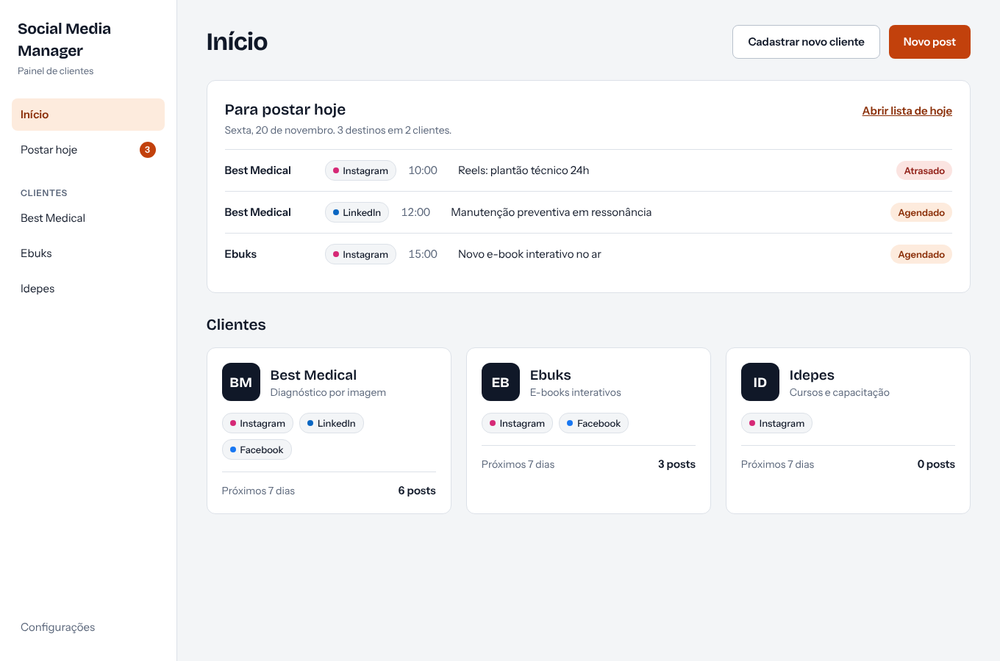
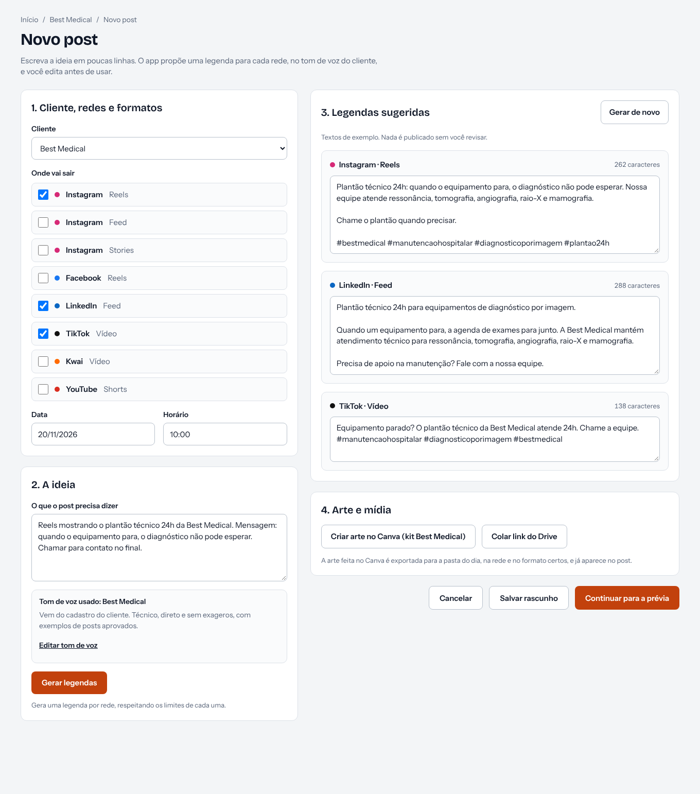
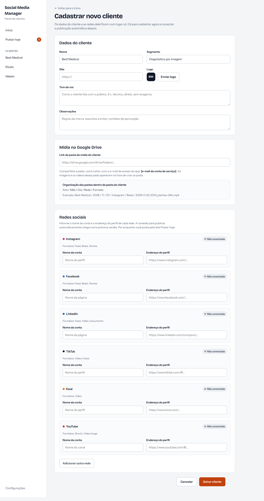
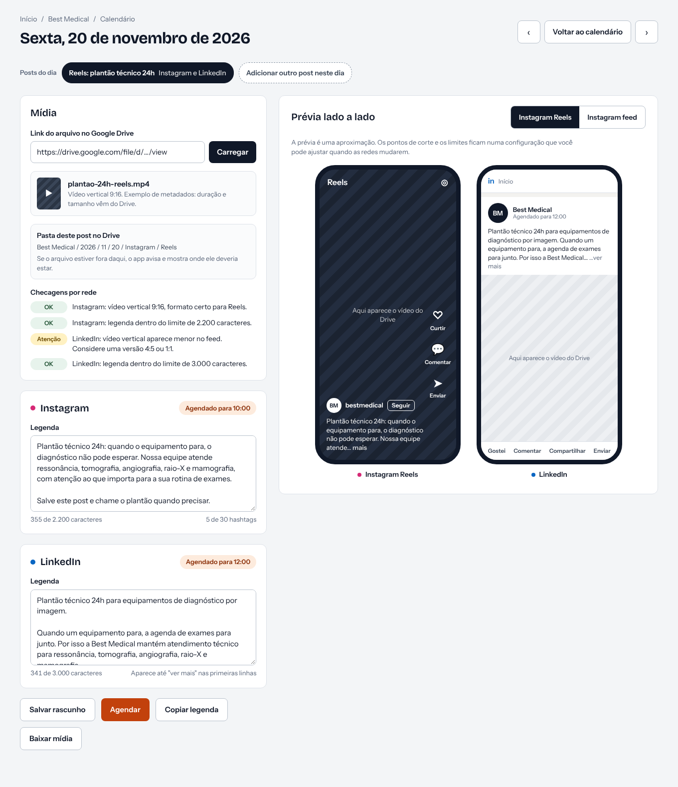
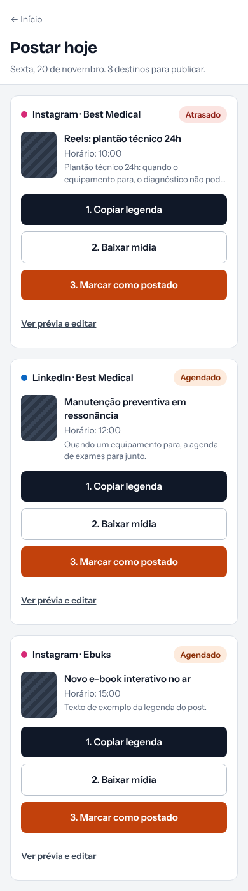

# Social Media Manager

App multi-cliente para planejar, criar e acompanhar posts em várias redes sociais. O primeiro cliente é a Best Medical.

**Estado atual:** etapa 1 do app construída (clientes, calendário, novo post, dia com prévia, postar hoje, leitura de mídia do Drive). O protótipo visual aprovado continua em [`prototipo/`](prototipo/). Nas imagens abaixo, nomes, horários e textos são exemplos.

Para rodar, publicar e ver o que falta, leia [`CLAUDE.md`](CLAUDE.md) e [`docs/DEPLOY.md`](docs/DEPLOY.md).

## Telas do protótipo

### 1. Início
O que postar hoje e os cartões dos clientes.

### 2. Novo post
A pessoa escreve a ideia. O app propõe uma legenda por rede, no tom de voz cadastrado do cliente, e a pessoa edita antes de usar.

### 3. Cadastrar cliente
Dados do cliente, pasta de mídia no Google Drive e as redes com seus formatos.

### 4. Calendário do cliente
Visão do mês com filtros por rede e por status (rascunho, agendado, postado).

### 5. Dia e visualizador
Mídia a partir do Google Drive, checagens por rede, legendas com contador e prévia lado a lado em celular.

### 6. Postar hoje (celular)
Lista do dia com os passos: copiar legenda, baixar mídia, marcar como postado.

As páginas HTML estáticas estão em [`prototipo/`](prototipo/). Para navegar entre elas, baixe o repositório e abra `prototipo/inicio.html` no navegador.

## Decisões até aqui

- **Redes:** Instagram, Facebook, LinkedIn, TikTok, Kwai e YouTube.
- **Formatos por rede:** Instagram e Facebook (Feed, Reels, Stories), LinkedIn (Feed, Vídeo, Documento), TikTok (Vídeo, Fotos), Kwai (Vídeo), YouTube (Shorts, Vídeo longo).
- **Publicação:** manual na primeira versão (copiar legenda, baixar mídia, marcar como postado). Publicação automática depois, por uma ferramenta como Buffer, Metricool ou Zapier.
- **Mídia no Google Drive**, em pastas `Cliente / Ano / Mês / Dia / Rede / Formato`. O app guarda o ID do arquivo no banco, então o caminho serve para organização e conferência, não para localizar o arquivo.
- **Acesso ao Drive:** conta de serviço com a pasta do cliente compartilhada como Editor: o app lê arquivos e cria só as pastas do post (nunca envia, move nem apaga).
- **Legendas com IA:** o app chama o Claude pela API, com o tom de voz do cliente, exemplos de posts aprovados e os limites de cada rede. Sempre com revisão humana.
- **Artes:** kit de marca no Canva, em fase posterior.
- **Pilha prevista:** Next.js e Postgres, hospedados no Render.
- **Acesso:** um usuário com senha agora. Vários usuários depois.
- As prévias são aproximações. Pontos de corte, proporções e limites de caracteres ficam numa configuração editável.

## Próximos passos

1. Publicar a etapa 1 no Render e testar com a pasta real do Drive.
2. Etapa 2: legendas com IA no tom de voz do cliente, prévias de TikTok, Kwai e YouTube.
3. Etapa 3: templates por rede e formato, artes no Canva.
