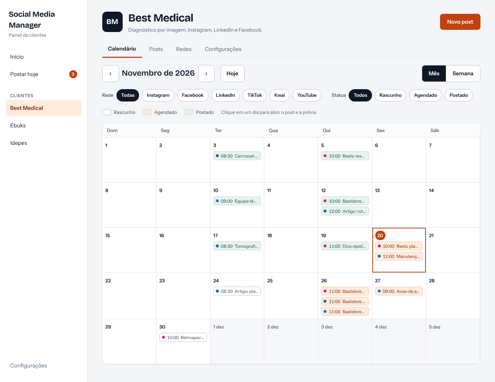

# Social Media Manager

App multi-cliente para planejar, criar e acompanhar posts em várias redes sociais. O primeiro cliente é a Best Medical.

**Estado atual:** app em produção no Render com clientes, calendário, visão da semana, módulo Editorial (pilares, banco de ideias, roteiros e cronograma), novo post em três etapas, tela do dia com prévias para todas as redes, Postar hoje, leitura/criação de pastas no Google Drive, legendas com IA (Gemini ou Claude, com memória contínua e cópia de pedido) e publicação direta/agendada pelo app. O protótipo visual aprovado continua em [`prototipo/`](prototipo/). Nas imagens abaixo, nomes, horários e textos são exemplos.

Para rodar, publicar e ver o que falta, leia [`CLAUDE.md`](CLAUDE.md) e [`docs/DEPLOY.md`](docs/DEPLOY.md).

## Telas do protótipo

### 1. Início
O que postar hoje e os cartões dos clientes.

### 2. Novo post
A pessoa escreve a ideia. O app propõe uma legenda por rede, no tom de voz cadastrado do cliente, e a pessoa edita antes de usar.

### 3. Cadastrar cliente
Dados do cliente, pasta de mídia no Google Drive e as redes com seus formatos.

### 4. Calendário do cliente
Visão do mês com filtros por rede e por status (rascunho, agendado, postado).

### 5. Dia e visualizador
Mídia a partir do Google Drive, checagens por rede, legendas com contador e prévia lado a lado em celular.

### 6. Postar hoje (celular)
Lista do dia com os passos: copiar legenda, baixar mídia, marcar como postado.

As páginas HTML estáticas estão em [`prototipo/`](prototipo/). Para navegar entre elas, baixe o repositório e abra `prototipo/inicio.html` no navegador.

## Decisões atuais

- **Redes:** Instagram, Facebook, LinkedIn, TikTok, Kwai e YouTube.
- **Formatos por rede:** Instagram e Facebook (Feed, Reels, Stories), LinkedIn (Feed, Vídeo, Documento), TikTok (Vídeo, Fotos), Kwai (Vídeo), YouTube (Shorts, Vídeo longo).
- **Publicação:**
  - **Instagram e Facebook:** publicação direta pelo app ("Publicar agora" ou automática no horário após clicar em "Confirmar publicação", via Graph API da Meta).
  - **LinkedIn (perfil pessoal, Feed e Vídeo):** publicação direta e automática no horário pelo app. Documento (PDF) e página de empresa seguem manuais.
  - **TikTok (Vídeo e Fotos):** envio como rascunho para a caixa de entrada do TikTok ("Enviar como rascunho"), onde a pessoa conclui a publicação no app do TikTok (publicação direta depende de auditoria do app no TikTok).
  - **YouTube, Kwai e LinkedIn Documento:** fluxo manual assistido (copiar legenda, baixar mídia, marcar como postado com opção de desfazer).
  - Nada é publicado sem ação explícita da pessoa ("Publicar agora" ou "Confirmar publicação").
- **Mídia no Google Drive:** pastas `Cliente / Ano / MM - Mês / Dia / <pasta do grupo>` para formatos verticais compartilhados (`Reels-Shorts-TikTok-Kwai` e `Stories`) e `Rede / Formato` para os demais; `Logotipo` fica no nível do cliente. O app guarda o ID do arquivo no banco, então o caminho serve para organização e conferência.
- **Acesso ao Drive:** conta de serviço com a pasta do cliente compartilhada como Editor: o app lê arquivos e cria só as pastas do post (nunca envia, move nem apaga).
- **Legendas e Editorial com IA:** usa Google Gemini (`GEMINI_API_KEY`, com prioridade) ou Anthropic Claude (`ANTHROPIC_API_KEY`) para legendas, considerando tom de voz, tons do post, observações do cliente, limites da rede e memória contínua aprendida com as edições; o botão "Copiar pedido para a IA" monta exatamente o mesmo pedido no servidor. O módulo Editorial usa Gemini ou modo gratuito de copiar/colar JSON. Sempre com revisão humana.
- **Pilha:** Next.js (App Router, TypeScript) e Postgres (`pg`, sem ORM), hospedados no Render.
- **Acesso:** usuário único com senha em banco (ou `APP_PASSWORD`). Vários usuários ficam para uma etapa futura.
- As prévias são aproximações. Pontos de corte, proporções e limites de caracteres ficam numa configuração editável (`src/config/networks.ts`).

## Próximos passos

1. Conectar e validar LinkedIn e TikTok reais em produção (dependem das credenciais dos respectivos portais de desenvolvedores).
2. Configurar `RESEND_API_KEY` e `NOTIFY_EMAIL_TO` no Render para avisos por e-mail da publicação automática.
3. Integrações e melhorias futuras: YouTube, publicação direta no TikTok (após auditoria), LinkedIn de página de empresa, templates por rede, aprovação do cliente e múltiplos usuários.
